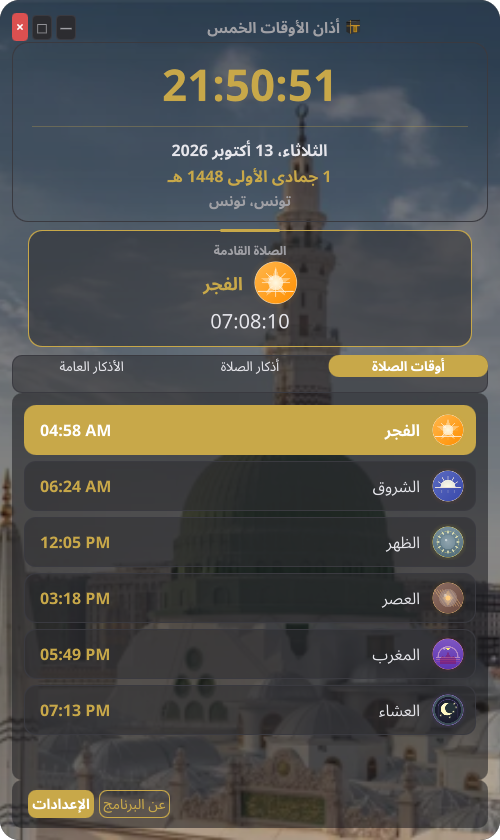
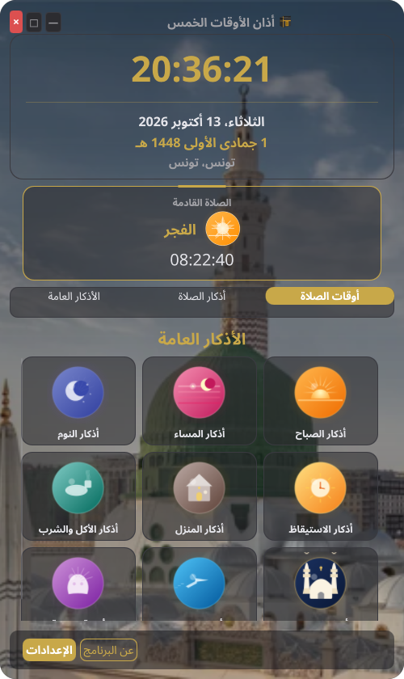
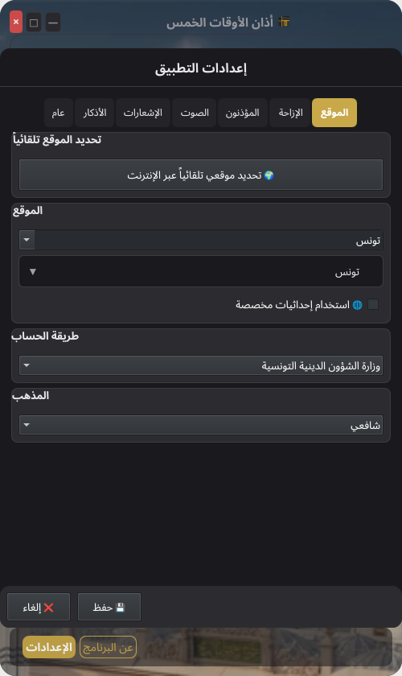

# أذان الأوقات الخمس (Athan Five Times)

[](https://github.com/HtoZ27/Athan-Five-Times/actions/workflows/ci.yml)
[](https://github.com/HtoZ27/Athan-Five-Times/releases)
[](LICENSE)

> **Beta (0.3.3b)** — This is a beta release: not yet bug-free, not yet
> tested on all Linux environments, and translations are still unreviewed.
> Bug reports are welcome via GitHub Issues.

A Linux desktop prayer-times application with azan audio, structured adhkar, do-not-disturb, and multi-language support. Built with Python + PySide6 (Qt6/QML).



## Screenshots

| Prayer times | Adhkar library |
|---|---|
|  |  |

| Morning adhkar | Settings |
|---|---|
|  |  |

## Features

- **Prayer Times** — Accurate calculation (MWL, Umm Al-Qura, Egyptian, Tunisian + 20 more), per-prayer icons, live countdown, Hijri date
- **Audio Azan** — Streaming MP3 playback with fade-in, volume control, multiple muezzins + per-prayer audio, takbeer mode
- **Adhkar Library** — 10 structured categories (74 remembrances) with repetition counts and source references, Arabic-Indic numerals
- **System Tray** — Mosque icon, next-prayer tooltip, show/quit menu, optional visibility, no-ghost quit
- **DND Integration** — Auto system-wide do-not-disturb around prayer times (GNOME)
- **Themes** — Dark/Light/Ottoman Gold/Catppuccin + auto, per-component palettes
- **Multi-language** — 17 languages with RTL support and live switching
- **Custom Offsets** — Per-prayer minute adjustments, madhab choice, high-latitude rule
- **City Search** — Virtual-scrolled picker (240 countries, 9000+ cities) with validation
- **Display Backend** — OpenGL/software render selection for GPU-less systems
- **Single Instance** — Second launch notifies instead of duplicating audio

## Requirements

- Python 3.10+
- PySide6 (Qt6), adhan, miniaudio
- Linux with PulseAudio/PipeWire for audio; `notify-send` optional (tray fallback built in)

## Installation

Download the AppImage from the releases page, make it executable and run it:

```bash
chmod +x Athan-Five-Times-x86_64.AppImage
./Athan-Five-Times-x86_64.AppImage
```

Or install a native package (also on the releases page):

```bash
# Debian / Ubuntu
sudo dpkg -i athan-five-times_0.3.3b_all.deb
sudo apt-get install -f   # pulls python3-pyside6* if missing
pip install adhan miniaudio
athan-five-times

# Fedora / openSUSE (from spec)
sudo dnf install athan-five-times-0.3.3b-1.noarch.rpm

# Arch Linux (from PKGBUILD)
makepkg -si   # inside packaging/arch, or use the AUR
```

Or run from source:

```bash
pip install -r requirements-lock.txt
./run.sh
```

## Development

```bash
pip install -e ".[dev]"
python -m pytest tests/          # 220+ tests
python3 scripts/smoke-qml.py     # QML zero-error gate
python3 scripts/e2e-features.py  # isolated end-to-end (44 checks)
```

`AppDir/` is derived build staging — regenerate with `bash scripts/sync-appdir.sh` (use `--check-only` in CI).

Native packages live under `packaging/`:

```bash
bash packaging/debian/build-deb.sh        # needs dpkg-deb → .deb
bash packaging/rpm/build-rpm.sh           # needs rpmbuild → .rpm
cd packaging/arch && makepkg -si          # Arch
```

## الخصوصية / Privacy

عند التشغيل الأول فقط يحاول التطبيق تخمين مدينتك عبر بحث IP
‏(`ip-api.com` ثم `ipapi.co` ثم `ipinfo.io`) لضبط الموقع مسبقاً. لا حسابات،
لا تتبع، ولا أي استخدام آخر للشبكة. يمكنك تغيير المدينة أو حذفها في أي وقت
من الإعدادات ← الموقع، أو البقاء دون إنترنت للإبقاء على الافتراضي (تونس).

On first run only, the app attempts one IP-geolocation lookup (`ip-api.com`,
then `ipapi.co`, then `ipinfo.io`) to preset your city. No accounts, no
tracking, no other network use. Change or clear the location anytime in
Settings → Location, or stay offline to keep the default (Tunis).

## License

See [LICENSE](LICENSE). Third-party credits: **عن البرنامج** dialog in the app.
